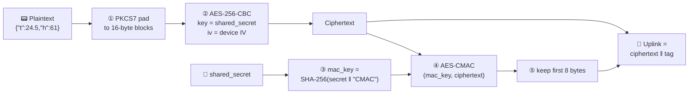

# 🔐 Sensor Uplink Encryption — Device ↔ Backend Contract

> **TL;DR** — Every sensor uplink must be **AES-256-CBC encrypted** and followed by an **8-byte AES-CMAC tag**.
> The backend checks the tag first. ❌ If the tag is wrong, the frame is **dropped**.

---

## 🧭 The big picture



### 📦 What goes over the air

```
┌──────────────────────────────────────────────┬──────────────────┐
│          CIPHERTEXT  (multiple of 16 B)       │  CMAC TAG (8 B)  │
└──────────────────────────────────────────────┴──────────────────┘
 ◄──────────── AES-256-CBC output ────────────► ◄─ first 8 bytes ─►
                                                    of AES-CMAC
```

Send these as **raw bytes** on a sensor FPort (**1–25**). ⚠️ Do **not** hex-encode or base64-encode them.

---

## 🔑 Inputs the device already has

| Name | Size | Source |
|---|---|---|
| `shared_secret` | **32 bytes** | ECDH (P-256): device private key × server public key |
| `iv` | **16 bytes** | The device's IV — the same one sent in `PUBKEY:<pub>:IV:<iv>` |
| `plain` | any | Sensor data |

---

## 🪜 Step by step (with real values)

The test inputs used below:
```
shared_secret = 000102030405060708090a0b0c0d0e0f101112131415161718191a1b1c1d1e1f
iv            = a0a1a2a3a4a5a6a7a8a9aaabacadaeaf
plain         = {"t":24.5,"h":61}          (17 bytes)
```

### ① PKCS7 padding
Add `N` bytes, each with value `N`, so the length becomes a multiple of 16 (`N` = 1…16).

```
{"t":24.5,"h":61}                        → 17 bytes
7b2274223a32342e352c2268223a36317d 0f0f0f0f0f0f0f0f0f0f0f0f0f0f0f
└────────── 17 bytes data ───────┘ └───── 15 × 0x0F padding ─────┘  = 32 bytes
```
> 💡 If the data is already 32 bytes, you still add **16 × `0x10`** → 48 bytes.

### ② AES-256-CBC encrypt
Use **all 32 bytes** of `shared_secret` as the key (AES-**256**) and the device `iv`.
```
ciphertext = baa2998362808769d928eae32ced618a1aae208d8c050523f963853d0982f9e5   (32 B)
```

### ③ Derive the MAC key  *(once per key exchange)*
```
input   = shared_secret (32 B) ‖ 43 4D 41 43   ("CMAC", 4 bytes, NO '\0')
mac_key = SHA-256(input)
        = d013ddea17e17e115e549059ee1f241fa6430d4a42bd9c8fd1b20781b947e4db
```

### ④ AES-256-CMAC over the **ciphertext**
```
CMAC(mac_key, ciphertext) = 1e1343fa5073aeba 591e6e522d1270a5   (16 B)
                            └── keep this ──┘ └── discard ───┘
```

### ⑤ Append the first 8 bytes
```
payload = baa2998362808769d928eae32ced618a1aae208d8c050523f963853d0982f9e5 1e1343fa5073aeba
          └──────────────────── ciphertext (32 B) ───────────────────┘ └── tag (8 B) ──┘
          = 40 bytes total
```

---

## 🖥️ What the backend does (for reference)

`iot_worker/key_rotation.py` → `SensorCrypto.decrypt()`

```
received 40 bytes
   │
   ├─► split: ciphertext = bytes[0:-8]   tag = bytes[-8:]
   │
   ├─► CMAC(mac_key, ciphertext)[:8] == tag ?
   │        ├── ❌ no  → log "CMAC verification failed", DROP frame
   │        └── ✅ yes ↓
   ├─► AES-256-CBC decrypt (shared_secret, iv)
   ├─► remove PKCS7 padding
   └─► {"t":24.5,"h":61}  → codec → DB / MQTT
```

```python
self.mac_key = SHA256.new(self.shared_secret + b"CMAC").digest()
tag = CMAC.new(self.mac_key, msg=ciphertext, ciphermod=AES, mac_len=8).digest()
```

---

## 💻 Device code (C / mbedTLS)

```c
#include <string.h>
#include <stdint.h>
#include "mbedtls/aes.h"
#include "mbedtls/cmac.h"
#include "mbedtls/sha256.h"

#define AES_BLOCK    16
#define CMAC_TAG_LEN 8

/* out must hold (plain_len/16 + 1)*16 + 8 bytes. Returns payload length or -1. */
int sensor_encrypt(const uint8_t shared_secret[32], const uint8_t iv[16],
                   const uint8_t *plain, size_t plain_len,
                   uint8_t *out, size_t out_size)
{
    /* ① PKCS7 padding */
    uint8_t pad_len    = AES_BLOCK - (plain_len % AES_BLOCK);
    size_t  padded_len = plain_len + pad_len;
    if (out_size < padded_len + CMAC_TAG_LEN) return -1;
    memcpy(out, plain, plain_len);
    memset(out + plain_len, pad_len, pad_len);

    /* ② AES-256-CBC (mbedTLS modifies the IV -> use a copy) */
    uint8_t iv_copy[16];
    memcpy(iv_copy, iv, 16);
    mbedtls_aes_context aes;
    mbedtls_aes_init(&aes);
    if (mbedtls_aes_setkey_enc(&aes, shared_secret, 256) != 0 ||
        mbedtls_aes_crypt_cbc(&aes, MBEDTLS_AES_ENCRYPT, padded_len,
                              iv_copy, out, out) != 0) {
        mbedtls_aes_free(&aes);
        return -1;
    }
    mbedtls_aes_free(&aes);

    /* ③ mac_key = SHA-256(shared_secret || "CMAC") */
    uint8_t kdf_in[36], mac_key[32];
    memcpy(kdf_in, shared_secret, 32);
    memcpy(kdf_in + 32, "CMAC", 4);                     /* no '\0' */
    mbedtls_sha256(kdf_in, sizeof(kdf_in), mac_key, 0);

    /* ④ AES-256-CMAC over the ciphertext */
    uint8_t full_tag[16];
    const mbedtls_cipher_info_t *info =
        mbedtls_cipher_info_from_type(MBEDTLS_CIPHER_AES_256_ECB);
    if (mbedtls_cipher_cmac(info, mac_key, 256, out, padded_len, full_tag) != 0)
        return -1;

    /* ⑤ append first 8 bytes */
    memcpy(out + padded_len, full_tag, CMAC_TAG_LEN);
    return (int)(padded_len + CMAC_TAG_LEN);
}
```

**Usage**
```c
uint8_t payload[64];
const char *msg = "{\"t\":24.5,\"h\":61}";
int n = sensor_encrypt(shared_secret, device_iv,
                       (const uint8_t *)msg, strlen(msg), payload, sizeof(payload));
if (n > 0) lorawan_send(fport, payload, n);    /* raw bytes, FPort 1–25 */
```

🛠️ **mbedTLS config:** enable `MBEDTLS_AES_C`, `MBEDTLS_CIPHER_MODE_CBC`, `MBEDTLS_CIPHER_C`, `MBEDTLS_CMAC_C`, `MBEDTLS_SHA256_C`.
On ESP-IDF, `CMAC` is **off by default** → `menuconfig → mbedTLS → CMAC support`.

---

## ✅ Self-test

Hard-code these, call `sensor_encrypt`, print as hex:

```c
uint8_t ss[32]; for (int i = 0; i < 32; i++) ss[i] = i;          /* 00 01 … 1f */
uint8_t iv[16]; for (int i = 0; i < 16; i++) iv[i] = 0xA0 + i;   /* a0 a1 … af */
const char *msg = "{\"t\":24.5,\"h\":61}";
```

**Expected output (40 bytes):**
```
baa2998362808769d928eae32ced618a1aae208d8c050523f963853d0982f9e51e1343fa5073aeba
```

---

## 🚨 Troubleshooting

| Symptom | Likely cause |
|---|---|
| 🟥 **All** bytes differ | Wrong padding (zero-padding instead of PKCS7), AES-128 instead of 256, wrong IV, or IV buffer reused after mbedTLS modified it |
| 🟧 Only the **last 8** bytes differ | `"CMAC"` sent with `'\0'` (5 bytes), MAC computed over **plaintext** instead of ciphertext, or used `shared_secret` directly instead of `mac_key` |
| 🟨 Backend log: `Payload too short for CMAC tag` | Tag not appended |
| 🟨 Backend log: `CMAC verification failed` | See 🟧 row |
| 🟨 Backend log: `Padding is incorrect` | CMAC OK, but padding/IV/key wrong before encryption |

---

## 📝 Notes

- 🔄 After every key rotation (new `UA_PUBKEY`), recompute `shared_secret` **and** `mac_key`.
- 🎚️ Backend switch: `SENSOR_CMAC_ENABLED` env var (default `true`). Set it to `false` only while old firmware without CMAC is still deployed.
